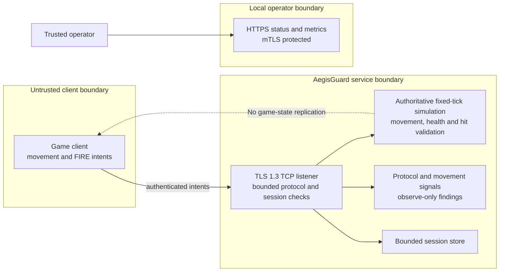
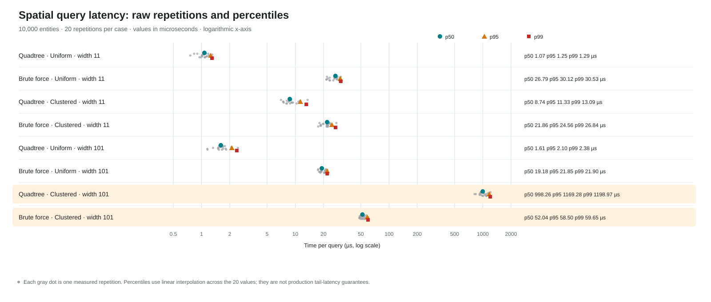

# AegisGuard

AegisGuard is a C++20 server-side game simulation and protocol validator for authoritative movement and combat.

[](https://github.com/siiick-brain/AegisGuard/actions/workflows/ci.yml)
[](https://github.com/siiick-brain/AegisGuard/actions/workflows/codeql.yml)

## Architecture



The service is a development prototype. It does not provide client-side
replication, game login, player provisioning or a complete match lifecycle.
Integrate it through one authoritative game-server state and adapt its rules to
the target game before deployment.

## What it detects

The detector records protocol violations. A signal does not establish cheating
or intent. Invalid traffic is rejected under the existing protocol controls.
The detector's applied action remains `observe`; it does not ban players or
apply account-level penalties.

| Cheat type or violation | Signal | Action |
|---|---|---|
| Out-of-range movement | `movement_out_of_range` | Reject frame and close connection |
| Replayed input | `replayed_sequence` | Reject frame and close connection |
| Excessive per-connection input rate | `movement_rate_exceeded` | Reject frame and close connection |
| Excessive reported movement speed | `speed_exceeded` | Reject frame and close connection |
| Teleport-sized reported displacement | `teleport_distance_exceeded` | Reject frame and close connection |
| Excessive aim rotation rate | `aim_snap_exceeded` | Reject frame and close connection |
| Excessive shared source-address rate | `ip_rate_exceeded` | Reject frame and close connection |
| Full pending movement queue | `movement_intent_queue_full` | Reject frame and close connection |

These are engineering rules with deterministic tests. No real-player false
positive rate or real-cheat coverage has been measured.

## Quick start

Use CMake 3.25 or newer, Ninja, a C++20 compiler, standalone Asio and OpenSSL
3.0 or newer with SSL and Crypto libraries. The initial configure fetches
GoogleTest and RapidCheck. On MSYS2 UCRT64 install the system packages:

```powershell
pacman -S --needed mingw-w64-ucrt-x86_64-asio mingw-w64-ucrt-x86_64-openssl
```

From the repository root in PowerShell, install the Python test tools and build
the server:

```powershell
python -m pip install -r requirements-dev.txt
cmake -S . -B build -G Ninja -DCMAKE_BUILD_TYPE=Debug
cmake --build build --parallel 2
```

Run the C++ and Python test suites plus the Python linters:

```powershell
ctest --test-dir build --output-on-failure --no-tests=error
$env:AEGISGUARD_BUILD_DIR = (Resolve-Path .\build).Path
python -m pytest -q tests/python
python -m ruff check .
python -m mypy tools
```

Provision local demo certificates outside the repository and start the server:

```powershell
.\scripts\setup-demo-secrets.ps1
.\build\server\aegisguard_server.exe --config config\demo.json
```

The demo binds to loopback. Keep the server running in that terminal. In a
second terminal run the existing anti-cheat and simulation scenarios:

```powershell
.\scripts\run-scenarios.ps1 -BuildDirectory build
```

The scenario script runs existing CTest cases in isolated loopback fixtures.
It does not connect a game client to the separately started server.

### Captured scenario output

Captured from `scripts/run-scenarios.ps1` on the checked-in test build:

```text
Running six existing server-authority scenarios.
1/6 Test  #52: NetworkServiceTest.ForgedPositionRejected ...........................   Passed    0.37 sec
2/6 Test  #53: NetworkServiceTest.SpeedCheatRejected ...............................   Passed    0.20 sec
3/6 Test  #54: NetworkServiceTest.TeleportCheatRejected ............................   Passed    0.22 sec
4/6 Test  #55: NetworkServiceTest.AimSnapCheatRejected .............................   Passed    0.17 sec
5/6 Test #113: SimulationTest.FireDamagesTheNearestServerOwnedTarget ...............   Passed    0.04 sec
6/6 Test #117: SimulationTest.RespawnsEliminatedPlayerAtItsServerOwnedSpawnPoint ...   Passed    0.06 sec
100% tests passed, 0 tests failed out of 6
Total Test time (real) =   1.32 sec
```

## Spatial benchmark



The graph shows p50, p95 and p99 from 20 raw repetitions for eight query cases
with 10,000 entities. The checked-in benchmark report describes the machine,
workloads and command sequence. The Quadtree was slower for the clustered
width-101 query: its p50 was 998.26 microseconds, compared with 52.04
microseconds for the brute-force scan. The graph is a synthetic spatial
microbenchmark, not a game-server performance claim.

## Security controls and limits

- The game listener uses TLS 1.3 and bounded protocol frames.
- Sessions use server-issued 256-bit credentials with expiry and revocation.
- Sequence checks and per-connection plus shared per-IP rate limits reject
  replayed or excessive input.
- The server owns movement, health and hit results. Client-reported position is
  used only for anomaly checks.
- Status and metrics endpoints require a trusted client certificate. The
  health endpoint is public on its configured listener.
- Demo credentials and keys are stored outside the repository with
  user-restricted permissions.

The service has no production credential issuance, certificate rotation,
player provisioning or state replication. The detector is observe-only and
has not been calibrated on real gameplay. Do not expose the current service to
public traffic.

## Testing

The latest recorded complete local CTest run passed 125 of 125 tests. Python
discovery passed 28 tests and two subtests. A fresh coverage build passed the
same 125 CTest tests and measured 91.5% line coverage, 81.0% branch coverage
and 97.5% function coverage for the defined core-source scope. The required
line and branch thresholds are 90% and 80%.

Reproduce the coverage run with the steps in
[the coverage report](docs/testing/COVERAGE_REPORT.md). For fuzz and sanitizer
status see the [release acceptance checklist](docs/testing/RELEASE_ACCEPTANCE.md).
The local scenario command above exercises six existing anti-cheat and
server-simulation cases.

## Project layout

| Path | Purpose |
|---|---|
| `server/include/aegisguard` | Public C++ interfaces |
| `server/src` | Simulation, protocol and service implementations |
| `tests/unit` | Unit and network integration tests |
| `tests/property` | Property-based tests |
| `tests/fuzz` | Fuzz targets and regression inputs |
| `tests/python` | Python utility and server smoke tests |
| `tools` | Offline movement evaluation and benchmark utilities |
| `benchmarks/results` | Captured benchmark inputs and graph |
| `docs` | Architecture, protocol, security and test documentation |
| `scripts` | Local provisioning, style and scenario checks |

## Roadmap

### Planned

- Integrate with a specific game's server loop, player lifecycle and replication path.
- Match movement, combat, collision, respawn and match rules to the target game.
- Add outbound state replication and client-facing acknowledgments through the
  selected game's existing network protocol.
- Define production credential issuance and certificate provisioning plus
  rotation before any public deployment.
- Evaluate detection thresholds against representative, consented gameplay data.
- Verify load, soak, recovery, sanitizer, fuzzing and container security checks
  on supported release environments.
- Define telemetry retention and deletion controls before collecting persistent
  player data.

The detailed list is in the [roadmap](docs/roadmap.md). Server-side health and
hit validation are implemented; connecting those systems to a specific game
remains planned.

## License

MIT. See [LICENSE](LICENSE).
